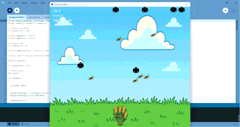

# Java-Mouse_Click-Game
Designed a mouse-controlled 2D game with computer-controlled enemies and added file handling to store and manage game data.

## Gameplay Preview

Technologies\

Java\
Processing\
Object-Oriented Programming\

Features\
Player movement\
Collision detection\
Scoring system\
